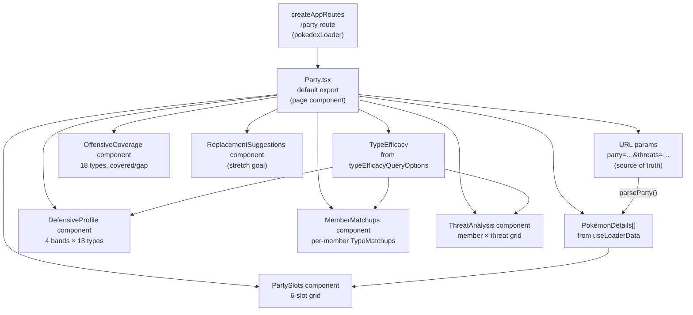

# Design Document

## Overview

The Party Analyzer is a new page at `/party` that lets users build a team of up to six Pokémon and inspect how those six work together. It covers four analysis areas—party defensive profile, party offensive coverage, individual member matchups, and threat-type analysis—plus a stretch-goal replacement suggestion engine. All page state lives in URL search params so any configuration can be bookmarked or shared.

The feature reuses every piece of existing infrastructure: `pokedexLoader` for the Pokédex data, `typeEfficacyQueryOptions` for the type chart, `getTypeMatchups` / `getOffense` from `@utils/stats` for the analysis math, `PokemonDetails` as the domain type, and the same `ComboBox` picker pattern already used by the Compare page.

## Architecture



The page component holds no React state for the party itself. `parseParty` and `parseThreats` decode the URL on each render; `setParty` / `setThreats` write back via `setSearchParams({ replace: true, preventScrollReset: true })`, removing a param once it would be empty (no members, no threats).

Analysis functions (`computeDefensiveProfile`, `computeOffensiveCoverage`, `computeThreatGrid`, `rankReplacements`) are pure functions in a co-located `src/utils/partyAnalyzer/` module. They take plain data and return plain data, making them straightforward to test.

## Components and Interfaces

### Page component: `src/pages/Party.tsx`

Default export, lazy-loaded. Receives `PokemonDetails[]` via `useLoaderData`. Reads `TypeEfficacy` via `useQuery(typeEfficacyQueryOptions)`. Reads/writes party and threat params from `useSearchParams`.

```tsx
// URL param keys
const PARTY_PARAM = "party";     // "1,4,7,0,0,0" — 6 ids, 0 = empty
const THREATS_PARAM = "threats"; // "fire,water" — up to 3 type names
```

### Component tree

```
Party.tsx
├── PageHeader
│   └── <h1>Party Analyzer</h1>
├── PartySlots                       new component
│   └── PartySlot × 6               new component (slot grid cell)
│       ├── [empty] SlotPicker       new component (ComboBox wrapper)
│       └── [filled] slot content + remove button
├── [efficacy loaded] (with any party, including an empty one)
│   ├── DefensiveProfile             new component (empty party: prompt)
│   ├── OffensiveCoverage            new component (empty party: prompt)
│   ├── MemberMatchups               new component (empty party: nothing)
│   │   └── TypeMatchups             existing component (reused per member)
│   ├── ThreatAnalysis               new component (picker always; prompt until
│   │                                 there is a member and a threat)
│   └── ReplacementSuggestions       new component, stretch goal (nothing unless
│                                     there is a swap with a net gain)
└── [efficacy loading/error] inline message in place of the analysis
```

The analysis sections render as soon as the type chart has loaded, whatever the party, so the prompts of Requirements 2.6, 3.5 and 5.11 can show. They receive the filled members (`party.filter(Boolean)`); `ReplacementSuggestions` receives all six slots.

### `PartySlots`

Props: `party: (PokemonDetails | null)[]`, `allPokemon: PokemonDetails[]`, `onSet: (index: number, id: number | null) => void`

Renders a CSS grid of exactly six `PartySlot` elements. The grid is `grid-cols-2 md:grid-cols-3`.

### `PartySlot`

Props: `index: number`, `pokemon: PokemonDetails | null`, `allPokemon: PokemonDetails[]`, `selectedIds: number[]`, `onSet: (id: number | null) => void`

- Empty: renders a `SlotPicker` (a `ComboBox` labelled `"Slot N Pokémon"`).
- Filled: renders a mini card (sprite, name, type pills) and a `Button` labelled `"Remove [name]"`.

### `SlotPicker`

Props: `index: number`, `allPokemon: PokemonDetails[]`, `excludedIds: number[]`, `onSelect: (id: number) => void`

Replicates the `Picker` from `Compare.tsx`: React Aria `ComboBox` → `Input` → `Popover` → `ListBox`. Suggestions via `getPokemonSuggestions` capped at 8, filtered to exclude `excludedIds`. Aria label: `"Slot N Pokémon"`.

### `DefensiveProfile`

Props: `party: PokemonDetails[]`, `efficacy: TypeEfficacy`

Leaves out any member whose types fail `hasTypeData` (Missing Type Data) and lists them as `"Type data unavailable for [name]"` beneath the bands. Calls `computeDefensiveProfile(knownMembers, efficacy)` and renders four `Panel as="section"` sections in order: Immune, Resistant, Neutral, Weak. Each section has a `SectionLabel` heading and a flex-wrap row of type pills. Weak pills additionally show a count badge (e.g. `3 weak`) via an `sr-only` text node and a visible numeric badge.

### `OffensiveCoverage`

Props: `party: PokemonDetails[]`, `efficacy: TypeEfficacy`

Calls `computeOffensiveCoverage(party, efficacy)` and renders all 18 types. Covered types use the standard `typePillClass` (the same chip as every other pill on the page); gap types use an outlined variant of it (no fill, dashed `border-line-strong` border, muted text). An `sr-only` span next to each gap pill reads `"Coverage gap"` for screen readers.

### `MemberMatchups`

Props: `party: PokemonDetails[]`, `efficacy: TypeEfficacy`

Renders one `Panel as="section"` per filled slot. Inside each panel: sprite, name, type pills, then `<TypeMatchups types={pokemon.types} efficacy={efficacy} />`. If one of the member's types fails `hasTypeData`, shows `"Type data unavailable"`; otherwise, if `getTypeMatchups` returns no groups, shows `"No weaknesses or resistances"`. Section aria label: `"[name] matchups"`.

### `ThreatAnalysis`

Props: `party: PokemonDetails[]`, `threats: string[]`, `efficacy: TypeEfficacy`, `onAddThreat: (type: string) => void`, `onRemoveThreat: (type: string) => void`

Renders a threat picker (a React Aria `Select` of the 18 types minus those already added, aria label `"Add a threat type"`, disabled when `threats.length >= 3`). A `Select` rather than a `ComboBox`: with 18 fixed options there is nothing to search, and a `ComboBox` reopens its list after each pick (clearing its text counts as typing), covering the grid, remove buttons per threat (aria label `"Remove [type] threat"`), and a grid table when `party.length > 0 && threats.length > 0`. Cell content is the multiplier label; cell background is color-coded per multiplier band. Each cell also contains an `sr-only` description via `describeMatchup`.

### `ReplacementSuggestions` (stretch goal)

Props: `party: (PokemonDetails | null)[]` (the six slots), `allPokemon: PokemonDetails[]`, `efficacy: TypeEfficacy`

Calls `rankReplacements(party, allPokemon, efficacy)` and renders at most one suggestion entry: the weakest member with its slot number (`slotIndex + 1`), and up to three candidate cards. Hides when no coverage gaps exist, fewer than two party members are present, or no candidate has a net coverage gain.

## Data Models

### URL params

| Param     | Shape                                              | Example            |
|-----------|----------------------------------------------------|--------------------|
| `party`   | Exactly 6 comma-separated integers, `0` = empty; omitted when every slot is empty | `1,4,7,0,0,0` |
| `threats` | 1–3 comma-separated lowercase type names; omitted when there are none | `fire,psychic` |

**Parse rules** (implemented in `src/utils/partyAnalyzer/`):

```ts
// parseParty returns exactly 6 entries; null for empty/unknown ids
parseParty(param: string | null, allPokemon: PokemonDetails[]): (PokemonDetails | null)[]

// parseThreats returns 0–3 valid type names; ignores unknowns, caps at 3
parseThreats(param: string | null): string[]

// serializeParty maps null → 0
serializeParty(party: (PokemonDetails | null)[]): string

// serializeThreats joins with comma
serializeThreats(threats: string[]): string
```

Validation rules:
- `parseParty`: if the param is absent or does not split to exactly 6 values, return 6 nulls. Each value must be a plain whole number (digits only; `4abc`, `1.5` and `-3` count as empty); `0`, unknown, or an id already placed in an earlier slot → null (a Pokémon never fills two slots).
- `parseThreats`: split on comma, filter to `TYPE_ORDER` members, drop repeats (first occurrence wins), take first 3.

### Analysis result types

```ts
// src/utils/partyAnalyzer/index.ts

export type DefensiveBand = "immune" | "resistant" | "neutral" | "weak";

export type DefensiveProfileEntry = {
    type: PartyType;       // attacking type name
    band: DefensiveBand;
    weakCount: number;     // number of members with multiplier ≥ 2× (0 for non-weak)
};

// computeDefensiveProfile returns one entry per attacking type (all 18)
export const computeDefensiveProfile = (
    party: PokemonDetails[],
    efficacy: TypeEfficacy
): DefensiveProfileEntry[]

export type CoverageEntry = {
    type: PartyType;
    covered: boolean;
};

// computeOffensiveCoverage returns one entry per type (all 18)
export const computeOffensiveCoverage = (
    party: PokemonDetails[],
    efficacy: TypeEfficacy
): CoverageEntry[]

export type ThreatGridRow = {
    pokemon: PokemonDetails;
    multipliers: Record<string, number>; // threatType → multiplier
};

export const computeThreatGrid = (
    party: PokemonDetails[],
    threats: string[],
    efficacy: TypeEfficacy
): ThreatGridRow[]

// --- stretch goal ---
export type ReplacementEntry = {
    slotIndex: number;
    currentPokemon: PokemonDetails;
    candidates: PokemonDetails[];   // up to 3
};

export const rankReplacements = (
    party: (PokemonDetails | null)[],   // the six slots, so slotIndex is the slot
    allPokemon: PokemonDetails[],
    efficacy: TypeEfficacy
): ReplacementEntry | null

// true when the chart mentions every one of `types`, as an attacking type (a
// row) or a defending type (a column); false means Missing Type Data
export const hasTypeData = (types: string[], efficacy: TypeEfficacy): boolean
```

### Analysis algorithms

**`computeDefensiveProfile`**

For each of the 18 attacking types in `TYPE_ORDER`:
1. For each party member, compute the effective multiplier using `getTypeMatchups` (the dual-type product is already handled inside that function).
2. Determine the band for the attacking type:
   - If any member has multiplier `≥ 2`: **Weak**
   - Else if any member has multiplier `0`: **Immune**
   - Else if any member has multiplier `≤ 0.5`: **Resistant**
   - Else: **Neutral** (every member is `1×`)
3. For the Weak band, count members with multiplier `≥ 2` → `weakCount`.

The band priority order is: **Weak > Immune > Resistant > Neutral**. A type that has both a 0× member and a 2× member is **Weak**: the weakness is a real hole the user needs to see, and one member's immunity does not protect the member who is weak (Requirement 2.2).

Members with Missing Type Data are filtered out by the caller (`DefensiveProfile`) with `hasTypeData` before this runs.

**`computeOffensiveCoverage`**

For each defending type in `TYPE_ORDER`:
1. For each party member, check if `getOffense(memberType, efficacy)` returns any group with `multiplier >= 2` that includes the defending type. Each member contributes from each of their own types; a type with Missing Type Data gets empty groups from `getOffense`, so it contributes nothing (Requirement 3.6).
2. If any member-type combination produces 2× against the defending type: **Covered**; otherwise: **Coverage Gap**.

> Note: `getOffense` takes a single attacker type. Each member may have two types, so both are checked independently.

**`computeThreatGrid`**

For each party member and each threat type, compute the effective multiplier using the same product logic as `getTypeMatchups` (multiply across the member's defending types).

**`rankReplacements`** (stretch goal)

1. Take the filled slots. Return null with fewer than 2, or when the party already covers all 18 types.
2. For each filled slot, count the types it covers that no other member covers → `uniqueContributions`.
3. The weakest slot is the one with the fewest unique contributions; ties broken by highest `pokemon.id`. `slotIndex` is its position among the six slots (empty ones included).
4. Source candidates: Pokémon with `isDefault` (no Mega, Gigantamax or other alternate forms) and `generationId === slot.pokemon.generationId`, excluding every species (`speciesId`) already in the party.
5. For each candidate, compute its **net coverage gain**: the number of types covered by the other members plus the candidate, minus the number covered by the current party. This counts the gaps the candidate closes minus the types only the current member covered, which the swap would lose. (Counting only "gaps closed" would suggest swaps that trade one gap for another: with Bulbasaur + Charmander, Squirtle closes fire but loses water.)
6. Keep candidates with a gain above 0. Sort descending by gain, then ascending by `id`. Return up to 3; null if none.

### Route registration

```ts
// src/utils/routes/index.tsx addition
dataRoute(
    "party",
    "/party",
    () => import("../../pages/Party"),
    loader,            // same pokedexLoader as /pokedex, /compare
    "There was an error loading the Pokédex. Please try again."
)
```

```ts
// src/components/Nav/index.tsx addition to NAV_ITEMS
{ to: "/party", label: "Party", Icon: Users }   // Users from lucide-react
```

### New utility module

`src/utils/partyAnalyzer/index.ts` — all pure analysis functions and URL param helpers for the party page, plus `hasTypeData` (the Missing Type Data check) and the `PartyType` type (one of the 18 type names). It has no type list of its own: `TYPE_ORDER` throughout this document is the one in `@utils/stats`, the games' order that the type chart page (`/types`) uses, so both pages list types the same way. Co-located `partyAnalyzer.test.ts`.

## Correctness Properties

*A property is a characteristic or behavior that should hold true across all valid executions of a system — essentially, a formal statement about what the system should do. Properties serve as the bridge between human-readable specifications and machine-verifiable correctness guarantees.*

### Property 1: Party URL round-trip

*For any* array of exactly six party slots (each either a valid Pokémon id from the loaded dex or null, with no id in two slots), serializing with `serializeParty` and then parsing with `parseParty` against the same dex produces an array equal to the original.

**Validates: Requirements 1.7, 1.8**

### Property 2: Threat URL round-trip

*For any* list of 0–3 valid type names, serializing with `serializeThreats` and then parsing with `parseThreats` produces a list equal to the original (same types, same order).

**Validates: Requirements 5.5, 5.6**

### Property 3: Defensive profile covers all 18 types

*For any* non-empty party and any valid `TypeEfficacy` table, `computeDefensiveProfile` returns exactly 18 entries, one per type in `TYPE_ORDER`, and every entry's `band` is one of `immune | resistant | neutral | weak`.

**Validates: Requirements 2.1, 2.2**

### Property 4: Defensive profile bands are mutually exclusive

*For any* party and efficacy table, no attacking type appears in more than one band in the result of `computeDefensiveProfile`.

**Validates: Requirements 2.2**

### Property 5: Weak and Immune bands are correct

*For any* party and attacking type: if at least one member takes 2× or more, `computeDefensiveProfile` assigns the type to **Weak** with `weakCount` equal to the number of such members; otherwise, if at least one member takes 0×, it assigns **Immune**.

**Validates: Requirements 2.2, 2.3**

### Property 6: Offensive coverage covers all 18 types

*For any* non-empty party and valid efficacy table, `computeOffensiveCoverage` returns exactly 18 entries, one per type in `TYPE_ORDER`, each classified as `covered` or not.

**Validates: Requirements 3.1, 3.2**

### Property 7: Party URL ignores invalid lengths

*For any* comma-separated string that does not split to exactly 6 values, `parseParty` returns an array of exactly 6 nulls.

**Validates: Requirements 1.9**

### Property 8: Threat parsing ignores unknown types

*For any* comma-separated string of mixed valid, invalid and repeated type names, `parseThreats` returns only the valid ones, each once (first occurrence), up to 3, in original order.

**Validates: Requirements 5.7, 5.8, 5.12**

### Property 9: Threat grid dimensions match inputs

*For any* party of size N and list of M threat types (0 ≤ N ≤ 6, 0 ≤ M ≤ 3), `computeThreatGrid` returns exactly N rows, each with exactly M entries in `multipliers`.

**Validates: Requirements 5.9**

### Property 10: Replacement candidates exclude party species

*For any* party and full Pokédex, `rankReplacements` returns candidates whose `speciesId` is not the species of any current party member.

**Validates: Requirements 6.6**

### Property 11: Replacement candidates come from same generation

*For any* party, `rankReplacements` returns candidates whose `generationId` equals the `generationId` of the Pokémon occupying the target slot, and every candidate is a default form (`isDefault`).

**Validates: Requirements 6.3**

### Property 12: A Pokémon never fills two slots

*For any* comma-separated string of six values, `parseParty` returns slots in which no Pokémon id appears more than once, and each id keeps its first position.

**Validates: Requirements 1.4, 1.12**

### Property 13: Suggested swaps always gain coverage

*For any* party and Pokédex, putting any candidate returned by `rankReplacements` into `slotIndex` makes `computeOffensiveCoverage` report strictly more covered types than before.

**Validates: Requirements 6.4, 6.7**

## Error Handling

| Scenario | Handling |
|---|---|
| `typeEfficacyQueryOptions` loading | Show inline `"Loading…"` text in place of all analysis panels (Requirement 8.6). |
| `typeEfficacyQueryOptions` error | Show inline `"Couldn't load type data. Please try again."` in place of analysis panels (Requirement 8.6). |
| A member's type is Missing Type Data (`hasTypeData` is false) | Exclude that member from band calculations; display `"Type data unavailable for [name]"` beneath the defensive profile (Requirement 2.7) and `"Type data unavailable"` in its matchups panel (Requirement 4.6). |
| A Pokémon id in `party` URL param not in the loaded dex | Treat slot as empty (Requirement 1.10). |
| `party` param has fewer/more than 6 comma-separated values | Ignore param entirely; render all slots empty (Requirement 1.9). |
| A type name in `threats` param not in `TYPE_ORDER` | Silently skip; continue parsing remaining values (Requirement 5.7). |
| `threats` param has more than 3 valid type names | Use only the first three (Requirement 5.8). |
| A member's type is Missing Type Data | `getOffense` returns empty groups for it, so that type contributes no coverage; the member's other type and the remaining members still count (Requirement 3.6). |
| The `party` param repeats an id, or `threats` repeats a type | Keep the first occurrence; later repeats become an empty slot or are dropped (Requirements 1.12, 5.12). |

All URL parsing is tolerant: invalid or partial values fall back to safe defaults rather than surfacing errors to the user. Errors from the type efficacy query are shown inline and do not crash the page.

## Testing Strategy

### Unit tests (`src/utils/partyAnalyzer/partyAnalyzer.test.ts`)

The analysis utilities are pure functions and the primary target for thorough automated testing.

- `parseParty`: valid params, missing param, wrong count, unknown ids, `0` values, repeated ids.
- `parseThreats`: valid list, more than 3 values (truncation), unknown type names, mixed valid/invalid, repeated types.
- `serializeParty` / `serializeThreats`: correctness of round-trip pairs.
- `computeDefensiveProfile`: single-type member, dual-type member, all-neutral party, known super-effective and immune scenarios, weak beating immune.
- `hasTypeData`: a type known as a row, a type known only as a column, a type the chart never mentions.
- `computeOffensiveCoverage`: single member covering some types, full-coverage party, empty party.
- `computeThreatGrid`: 1 member × 1 threat, 6 members × 3 threats, immune type (0×).
- `rankReplacements`: tie-breaking by highest id, real slot index with empty slots, net-gain ranking (no swap that trades one gap for another), exclusion of party species and non-default forms, generation filter, no candidates available.

**Property-based tests** (using [fast-check](https://fast-check.io)) implement the properties declared above. Each test uses a minimum of 100 iterations. Tests are tagged with `Feature: party-analyzer, Property N: <property text>` in a comment above each `fc.assert` call.

```ts
// Example tag format
// Feature: party-analyzer, Property 1: Party URL round-trip
fc.assert(fc.property(
    arbitraryParty(allPokemon),
    (party) => deepEqual(parseParty(serializeParty(party), allPokemon), party)
));
```

### Component tests (`src/pages/Party.test.tsx` and new component test files)

Each new component folder includes a `ComponentName.test.tsx`. Tests use `vitest-browser-react` and the existing test fixtures (`makePokemon`, `DEX`, `makeInfo`, `TestRouter`). Key scenarios:

- `PartySlots`: renders 6 slots; picking a Pokémon fills the slot; removing clears it; already-selected Pokémon are absent from the picker dropdown.
- `DefensiveProfile`: shows all 4 band sections; Weak band shows count badges; empty party shows prompt.
- `OffensiveCoverage`: covered and gap types are visually distinct; full coverage shows confirmation message.
- `ThreatAnalysis`: add-threat control is disabled at 3 threats; grid renders correct multipliers; removing a threat removes its column.
- `Party` (page): URL param parsing restores state on mount; party and threat changes write `replace: true` params.

### Storybook stories

Each new component has a `ComponentName.stories.tsx` with at least one story with a `play` function containing an `expect` call. The axe check is enforced by the existing `.storybook/vitest.setup.ts` harness. Stories use the `DEX` fixture and inline data-URI sprites.

### End-to-end tests (`e2e/party.spec.ts`)

The existing `mockPokeApi` mock covers the full 22-Pokémon fixture dex. E2E tests cover:

- Navigating to `/party` from the Nav.
- Adding two Pokémon and verifying the URL encodes them in `party=…`.
- Reloading the page and verifying the party is restored from the URL.
- Adding a threat type and verifying the grid appears.
- Removing a party member and verifying its slot reverts to empty.
